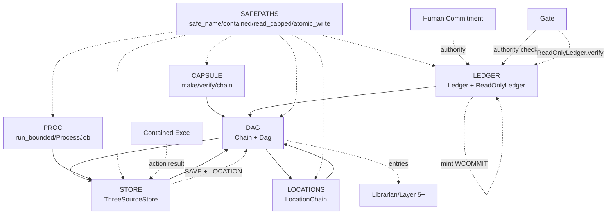

# vega-custody-sdk — Architecture

## 1. The organism (family picture)

The 16-layer stack from ORGANISM_MAP.md with this repo's layer marked:

```
                 ┌──────────────────────────┐
                 │   THE HUMAN (the owner)  │
                 └────────────┬─────────────┘
                              v
 15 assemble   vega-umbrella-sdk
 14 deliberate vega-council-sdk, vega-galaxy-sdk
 13 watch      vega-governance-feed-sdk
 12 verify     vega-metacog-sdk
 11 reason     vega-reasoning-sdk
 10 observe    vega-trace-sdk
  9 interface  vega-terminal-sdk
  8 learn      vega-train-sdk
  7 knowledge  vega-dkg-lattice-sdk
  6 conduct    vega-harness-sdk
  5 memory     vega-librarian-sdk
  4 contain    vega-two-gate-sdk
  3 adapt      vega-pareah-sdk
  2 seal       vega-superproof-sdk
  1 authority  vega-governance-jacket-sdk   >>> vega-custody-sdk <<<
  0 record     vega-custody-sdk
```

**What the layers below provide:** None — this is layer 0, the foundation. No dependencies.

**Who above consumes it:** Every other SDK in the family lists `custody` in its registry `requires`. The governance jacket (layer 1) records commitments here. The superproof (layer 2) records sealing stages here. The pareah adapter (layer 3) records inbound/outbound transfers here. The two-gate containment (layer 4) records contained executions here. The librarian (layer 5) reads lessons from here. The harness (layer 6) records predicted paths and use-gate checks here. The dkg-lattice (layer 7) builds the knowledge graph from here. Training (layer 8) records freeze cards here. Terminal (layer 9) records gated command executions here. Trace (layer 10) records reasoning traces here. Reasoning (layer 11) reads the lattice built from here. Metacog (layer 12) gates on evidence recorded here. Governance feed (layer 13) shows the chain from here. Council (layer 14) deliberates over records from here. Galaxy (layer 14) visualizes the lattice from here. Umbrella (layer 15) assembles the family and audits the registry — all depending on custody.

## 2. Internal drawing: modules and flows

```
┌─────────────────────────────────────────────────────────────────────────────┐
│                            VEGA-CUSTODY-SDK (layer 0)                       │
├─────────────────────────────────────────────────────────────────────────────┤
│                                                                             │
│  ┌──────────┐     ┌──────────────┐     ┌─────────────┐     ┌───────────┐  │
│  │ CAPSULE  │────▶│     DAG      │◀───▶│  LOCATIONS  │     │  STORE    │  │
│  │          │     │  (content +  │     │   CHAIN     │     │ (3-source)│  │
│  │ make/    │     │   location)  │     │             │     │           │  │
│  │ verify   │     │              │     │ record_     │     │ save/     │  │
│  │ chain    │     │ Chain:       │     │ location()  │     │ audit/    │  │
│  └──────────┘     │  - record()  │     └──────┬──────┘     │ load      │  │
│        ▲          │  - verify()  │            │            └─────┬─────┘  │
│        │          │  - record_or │            │                  │        │
│        │          │    _refuse   │            │                  ▼        │
│        │          └──────┬───────┘            │           ┌───────────┐  │
│        │                 │                    │           │  DAG      │  │
│        │                 ▼                    │           │  (both)   │  │
│        │          ┌──────────────┐            │           └───────────┘  │
│        │          │    LEDGER    │            │                  ▲        │
│        └─────────▶│  (mint/      │            │                  │        │
│                   │   verify/    │            │                  │        │
│  ┌──────────┐     │   anchor)    │            │                  │        │
│  │  PROC    │     │              │            │                  │        │
│  │          │     │ Backends:    │            │                  │        │
│  │ run_     │     │  - local     │            │                  │        │
│  │ bounded  │     │  - drive     │            │                  │        │
│  │          │     │  - witness   │            │                  │        │
│  └──────────┘     └──────────────┘            │                  │        │
│        ▲                 ▲                    │                  │        │
│        │                 │                    │                  │        │
│        └─────────────────┴────────────────────┴──────────────────┘        │
│                              │                                              │
│                              ▼                                              │
│                   ┌──────────────────┐                                     │
│                   │    SAFEPATHS     │  (used by all above for FS safety) │
│                   └──────────────────┘                                     │
│                                                                             │
└─────────────────────────────────────────────────────────────────────────────┘

AUTHORITY FLOW (down, from human commitment):
  Human commitment → jacket (layer 1) → Ledger.mint(WCOMMIT) → Ledger.verify() in gate
  → contained execution → Store.save(capsule) → DAG.record() + LocationChain.record_location()

DATA FLOW (up, from record):
  DAG.entries() → Librarian (layer 5) → dkg-lattice (layer 7) → reasoning/galaxy (layers 11/14)
  → metacog (layer 12) → feed/galaxy (layers 13/14) → Human
```

**Box legend (real module names):**
- CAPSULE = `vega_custody.capsule.capsule`
- DAG = `vega_custody.dag.dag.Chain` + `Dag`
- LOCATIONS = `vega_custody.dag.locations.LocationChain`
- STORE = `vega_custody.store.store.ThreeSourceStore` + `DirBackend`
- LEDGER = `vega_custody.ledger.ledger.Ledger` + `ReadOnlyLedger`
- PROC = `vega_custody.proc.run_bounded` + `ProcessJob`
- SAFEPATHS = `vega_custody.safepaths`

**Flow legend:**
- Solid arrows (▶/▶) = DATA flow (records, capsules, digests, entries)
- Dashed arrows (──) = AUTHORITY flow (human commitment → mint → gate verify → contained exec → record)
- The Ledger sits at the boundary: `mint()` is called by the commit step (authority), `verify()` and `reader()` are handed to gates (authority check), the DAG/Store record the resulting actions (data).

## 3. Mermaid version



## 4. Sequence: main scenario end to end

**Scenario:** An action attempts to run → gate checks commitment → contained execution → record written.

```
Human                          Jacket (L1)              Custody (L0)              Two-Gate (L4)             World
  │                              │                         │                         │                         │
  │ signs WCOMMIT                │                         │                         │                         │
  ├─────────────────────────────▶│                         │                         │                         │
  │                              │ mint(WCOMMIT)           │                         │                         │
  │                              ├────────────────────────▶│                         │                         │
  │                              │      MINT entry         │                         │                         │
  │                              │◀────────────────────────┤                         │                         │
  │                              │   receipt (leaf, seq)   │                         │                         │
  │                              │                         │                         │                         │
  │                              │    gate.verify(c)       │                         │                         │
  │                              ├────────────────────────▶│                         │                         │
  │                              │      ReadOnlyLedger     │                         │                         │
  │                              │◀────────────────────────┤                         │                         │
  │                              │       True/False        │                         │                         │
  │                              │                         │                         │                         │
  │                              │      if True:           │                         │                         │
  │                              │      run in containment │                         │                         │
  │                              │      ──────────────────▶│                         │                         │
  │                              │                         │                         │                         │
  │                              │                         │    proc.run_bounded()   │                         │
  │                              │                         ├────────────────────────▶│                         │
  │                              │                         │      status/out/err     │                         │
  │                              │                         │◀────────────────────────┤                         │
  │                              │                         │                         │                         │
  │                              │    capsule.make(result) │                         │                         │
  │                              │    store.save(capsule)  │                         │                         │
  │                              │    ────────────────────▶│                         │                         │
  │                              │                         │   write to 3 backends   │                         │
  │                              │                         │   read back all         │                         │
  │                              │                         │   DAG.record(SAVE)      │                         │
  │                              │                         │   Location.record_loc() │                         │
  │                              │                         │   ────────────────────▶│                         │
  │                              │                         │      receipt            │                         │
  │                              │                         │◀────────────────────────┤                         │
  │                              │                         │                         │                         │
  │                              │    action touches world │                         │                         │
  │                              │                         │                         │      side effect        │
  │                              │                         │                         │      ───────────────▶│ │
  │                              │                         │                         │                         │
```

**Key points:**
- Authority flows DOWN: human key → WCOMMIT → Ledger.mint (commit step) → ReadOnlyLedger.verify (gate) → containment → Store.save
- Data flows UP: Store.save → DAG (SAVE + LOCATION) → Librarian → dkg-lattice → reasoning → human
- The Ledger is the boundary: `mint` requires the human signature check; `verify`/`reader` is what gates receive.

## 5. Trust boundaries

| Boundary | What changes hands | What enforces it |
|---|---|---|
| **Human → Commitment** | Human signs a single-use commitment (WCOMMIT) with a key the model never holds. | `Ledger.mint()` calls `commitment_check(commitment)` — a callback that verifies the human signature (provided by `vega_jacket.humanauth.verify.commitment_signature_checker`). Without it, the ledger refuses to mint a WCOMMIT. |
| **Commit step → Ledger.mint** | The commit step (which checked the signature) calls `mint()`. No other code should hold `mint`. | `Ledger.reader()` returns a `ReadOnlyLedger` with ONLY `verify()` and `inclusion_proof()`. Gates and contained code receive this, not the full `Ledger`. |
| **Gate → Containment** | Gate passes only if `ReadOnlyLedger.verify(commitment)` is True. | `ReadOnlyLedger.verify()` re-reads the whole chain off disk, checks WCOMMIT signature if configured, returns `False` on ANY failure (fail closed). |
| **Containment → Record** | Contained execution result becomes a capsule, saved via `ThreeSourceStore.save()`. | `save()` verifies the capsule, writes to 3 backends with read-back, scores, records DAG entries. Any failure rolls back all writes and records `SAVE_ABORTED`. |
| **Record → Librarian/DKG** | `Dag.entries()` and `LocationChain.where()` are read by upper layers. | `Chain.verify()` re-reads replicas off disk; `Dag.verify()` checks both chains. Tamper → `ChainBroken` on open, `False` on verify. |
| **This kit → Every other SDK** | Every SDK depends on custody (registry `requires: ["custody"]`). | Registry check in `vega-umbrella-sdk` enforces `requires` point down layers only, no cycles, no two owners. |
| **Process → OS** | `proc.run_bounded()` / `ProcessJob` runs untrusted code. | Windows job object (kill-on-close, process limit, memory limit) or POSIX process group + SIGKILL. Kill confirmed by `wait()`. Docstring states: process control, not OS sandbox. |
| **Filesystem → This kit** | Untrusted repos/manifests provide paths. | `safepaths.contained()` resolves symlinks, refuses escape. `safe_name()` refuses device names, `..`, separators. `read_capped()` refuses oversize. `atomic_write()` prevents half-written files. |

---

*This architecture document describes the published reference implementation as tested. Where this document and the source disagree, the source wins.*
