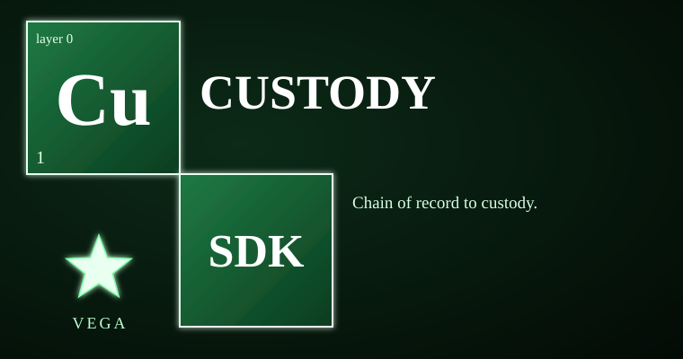

# vega-custody-sdk


<!-- vega-install-order -->
> **Build order: 1/1. This kit needs no other Vega kit.** You can install it on its own.
> Install it with `pip install --no-deps git+https://github.com/jasonblasiak868-code/vega-custody-sdk`. Full steps: [INTEGRATION_GUIDE](https://github.com/jasonblasiak868-code/vega-umbrella-sdk/blob/main/INTEGRATION_GUIDE.md).

The foundation every other Vega SDK writes to. This kit owns the **record** concern: capsules that chain every turn, an append-only DAG of what happened and where it lives, a ledger-agnostic mint that replicates to local disk and an external drive, and a three-source store that only commits when all copies verify. The failure it prevents: an action lands in the world but nothing durably records it, or the record can be quietly edited. Here, writing and recording are the same step — fail closed, hashes only, nothing but the chain.

> **Licensing.** Source-available, not open source. Free for personal use; free for registered small businesses (under US$1M revenue and valuation); everyone else needs a commercial license (see LICENSE; for a commercial license write to jasonblasiak.ai.mail@gmail.com). Patent pending. Draft licence text, not yet reviewed by an attorney.

## Why this exists

A model that can act needs a record that cannot be quietly changed. Prompts and policies do not solve this — they are promises, not mechanics. Self-checks do not solve this — the thing being checked is the thing doing the checking. A human reviewing every entry does not scale.

This kit does it differently: every turn becomes a capsule whose hash links to the previous one. Every save writes to three physical sources (local, external drive, server) and only succeeds when all three read back byte-for-byte. The ledger replicates to every configured backend atomically — record-or-refuse. An optional public witness anchors Merkle roots of batches, so thousands of commitments cost one small write. The code enforces this, not convention. Tampering breaks the chain; replicas that disagree refuse to open; a truncated chain is caught only if you kept a head elsewhere (that is the design, not a bug).

## Capabilities

| Capability | How you can check it |
|---|---|
| Capsule: wrap a turn (data + metadata + timestamp + predecessor hash + prefix hash) | `test_capsule.py` — 12 tests verify make/verify/verify_chain, tamper detection, forbidden fields |
| Append-only content DAG: multi-parent entries, no truncation, hash-linked, credential scan | `test_dag.py` + `redteam_1_chain_and_capsule.py` — 19+ tests verify DAG rules, record-or-refuse, tamper detection, concurrent writers |
| Location DAG: records where content lives with read-back digest verification | `test_dag.py` — location class enforcement, wrong read-back refused, unknown content refused |
| Ledger: mint single-use commitments (metadata + hash only), verify fail-closed | `test_ledger.py` — 28 tests verify mint, verify, single-use, missing fields, degraded optional drive |
| Merkle batching + public witness: root anchor, inclusion proofs | `test_ledger.py` + `redteam_4_witness.py` — batch anchor, proof verify, HTTPS-only calendar, redirect blocked |
| Three-source store: save only when all three backends hold exact bytes, scored, DAG recorded | `test_store.py` + `redteam_2_ledger_and_store.py` — 26+ tests verify save/audit/load, rollback on failure, nested sources refused |
| Bounded process execution: cap + timeout, verified kill of whole tree | `redteam_3_proc.py` — 5 tests verify overflow, timeout, grandchild kill, confirmed kill |
| Safe paths: safe_name, contained (symlink-resolved), read_capped, atomic_write | `redteam_5_audit_findings.py` — Windows device names, trailing dots/spaces, path traversal refused |

## Where it sits in the family

Layer 0 (record) — the foundation everything else writes to.

```
                 ┌─────────────────────────────────────────────────────────────────────┐
                 │   THE HUMAN (the owner)  │
                 └───────────────└───────────────────────────────────────────────┘
                              v
 15 assemble   vega-umbrella-sdk
 14 deliberate vega-council-sdk, vega-galaxy-sdk
 13 watch      vega-governance-feed-sdk
 12 verify     vega-metacog-sdk
 11 reason     vega-reasoning-sdk
 10 observe    vega-trace-sdk
  9 interface  vega-terminal-sdk
  8 learn      vega-train-sdk
  7 knowledge  vega-dkg-lattice-sdk
  6 conduct    vega-harness-sdk
  5 memory     vega-librarian-sdk
  4 contain    vega-two-gate-sdk
  3 adapt      vega-pareah-sdk
  2 seal       vega-superproof-sdk
  1 authority  vega-governance-jacket-sdk   >>> vega-custody-sdk <<<
  0 record     vega-custody-sdk
```

Dependencies: **none** (registry `requires: []`). Every other SDK in the family depends on custody — jacket, superproof, pareah, two-gate, librarian, harness, dkg-lattice, train, terminal, trace, reasoning, metacog, governance-feed, council, galaxy, umbrella all list `custody` in their `requires`.

One family, one organism: every SDK owns exactly one concern and uses the owner of every other concern instead of growing its own copy.

## Quick start

```bash
# From the repo root, put src on PYTHONPATH
export PYTHONPATH="$PWD/src:$PYTHONPATH"

python3 -c "
from vega_custody.capsule import capsule as cap
from vega_custody.dag.dag import Dag
from vega_custody.store.store import DirBackend, ThreeSourceStore
import tempfile, pathlib

t = pathlib.Path(tempfile.mkdtemp())
dag = Dag([t / 'c.jsonl'], [t / 'l.jsonl'])
backends = {'local': DirBackend(t / 'local'),
            'external': DirBackend(t / 'ext'),
            'server': DirBackend(t / 'srv')}
store = ThreeSourceStore(backends, dag)

c = cap.make('hello custody', {'source': 'user', 'license_class': 'own'})
r = store.save(c)
print('saved:', r['data_sha256'][:16], 'score:', r['score']['score'])
print('dag verifies:', dag.verify()[0])
"
```

## What it does NOT do

- It records and checks; it does not decide what is allowed (that is the governance jacket).
- A hash chain proves order and tamper evidence, not that the recorded content is true.
- An external drive and a server are only as safe as their operators.
- Public-chain anchoring backends beyond local, drive, and timestamp are interfaces only (not built).
- Containment is process-level, not an OS sandbox — hostile code belongs in a VM or container.
- License matrix is policy, not legal advice.
- Not independently security-reviewed; cryptography not expert-reviewed.
- The human is still the weak point: careless approvals cannot be fixed by code.

## Tests

114 tests in 10 files, all passing (per STATUS.md / REVIEW.md).

Run any test file directly — each is a self-contained script that exits 0 on pass:

```bash
export PYTHONPATH="$PWD/src:$PYTHONPATH"
python3 tests/test_capsule.py
python3 tests/test_dag.py
python3 tests/test_ledger.py
python3 tests/test_store.py
python3 tests/redteam_1_chain_and_capsule.py
python3 tests/redteam_2_ledger_and_store.py
python3 tests/redteam_3_proc.py
python3 tests/redteam_4_witness.py
python3 tests/redteam_5_audit_findings.py
```

## Status & honesty

Reference implementation, work in progress, not independently security-reviewed, crypto not expert-reviewed.

This kit details one branch of a broader filed architecture. The remaining branches are the subject of filed disclosures and are outside the scope of this repository.
